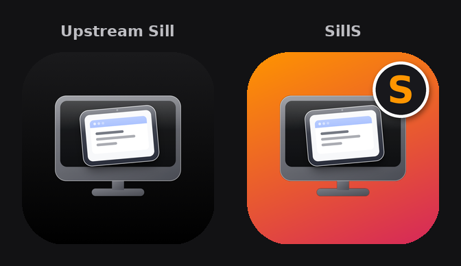
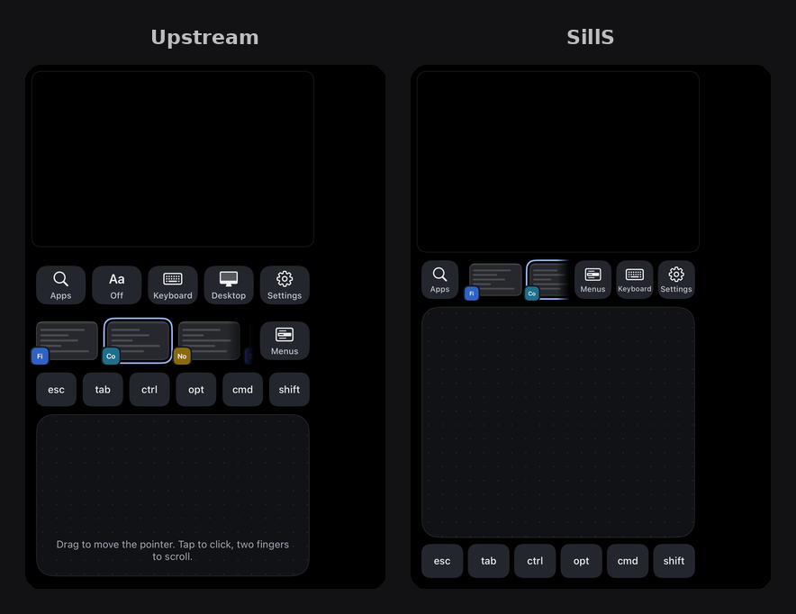
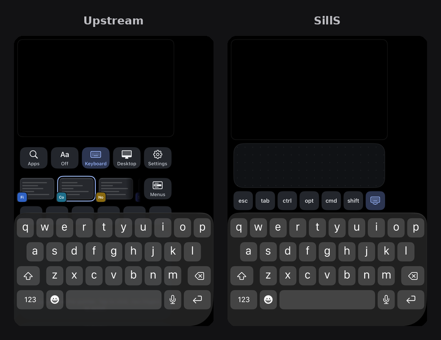
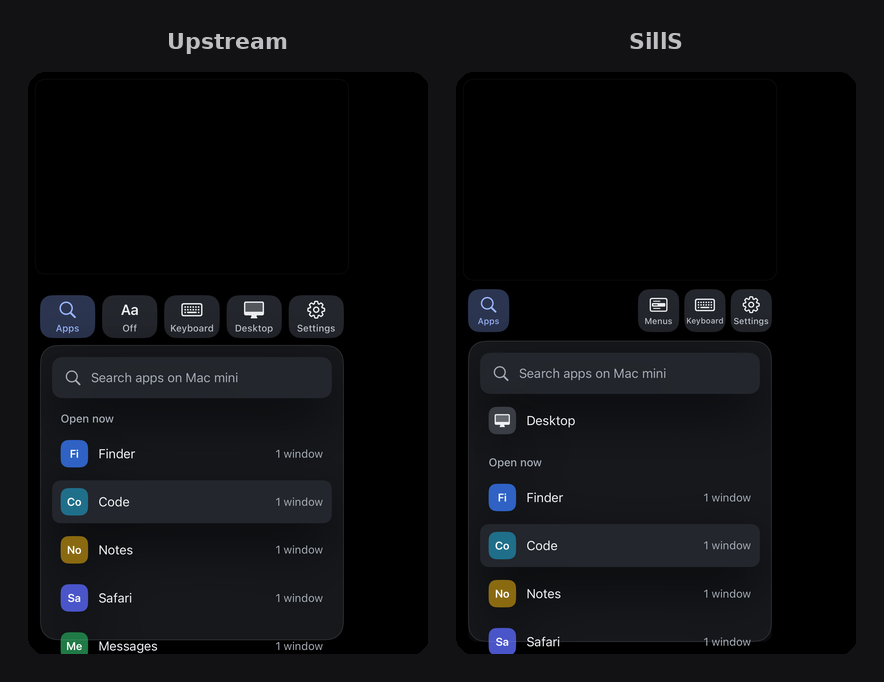
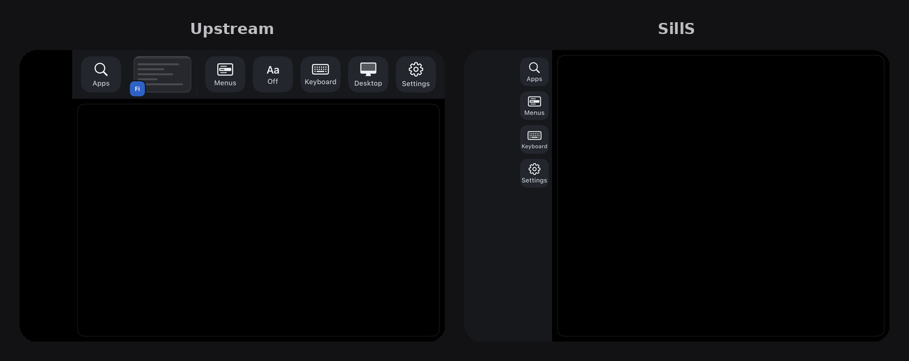
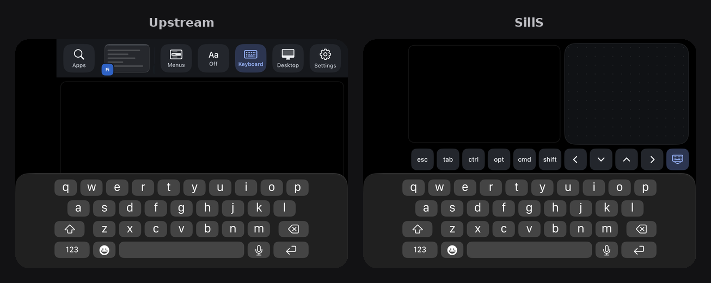
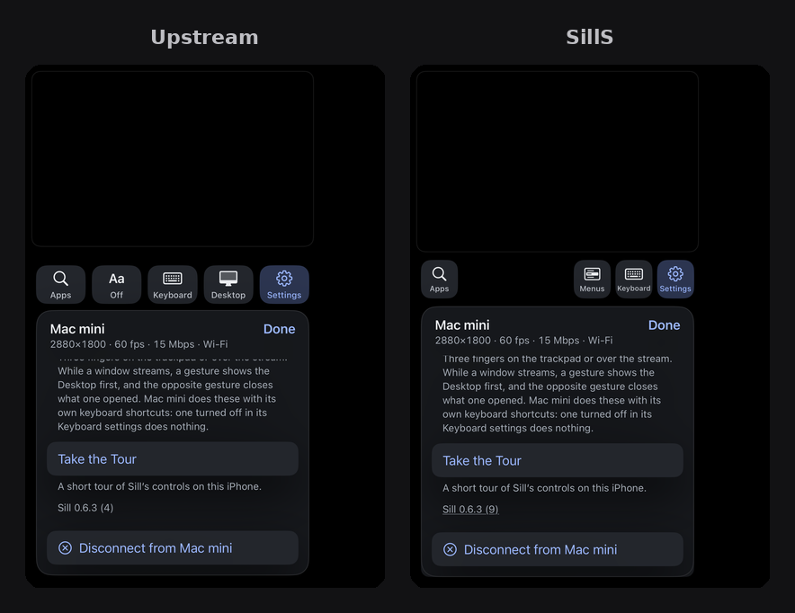
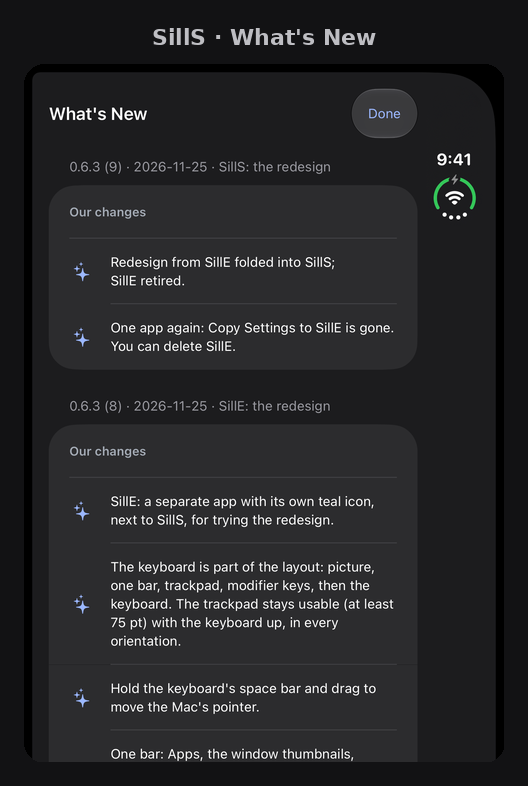

# SillS

SillS is a fork of [Saffsanity/sill](https://github.com/Saffsanity/sill).

Sill shows a window from your Mac, or the whole desktop, on your iPhone or iPad. You use it there with touch, a trackpad, a keyboard or Apple Pencil. The Mac and the device connect on the same network, over a USB cable, with Direct Wireless Connection, or through your own VPN, such as Tailscale. There is no account and no server in between.

This branch (`sills-redesign`) is SillS 0.6.3 (9), against upstream `c33d105` (Sill 0.6.3, 20 November 2026).

## What this fork adds

- **Name and icon.** The app is called SillS, with its own icon, so you can tell it from upstream Sill.

  

- **Portrait layout.** The keyboard is part of the layout: picture, one bar, trackpad, modifier keys, then the keyboard. The trackpad stays usable with the keyboard up. Larger Picture is gone; this layout replaces it.

  

  

- **One bar.** Apps, the window thumbnails, Menus, Keyboard and Settings. Desktop is the first row of Apps; text size (Aa) is in Settings.

  

- **Landscape.** A slim rail on the side instead of the top bar. With the keyboard up, the picture sits on the left and a trackpad on the right.

  

  

- **Trackpad zoom.** Pinch with two fingers on the trackpad to zoom the picture. Two-finger drag pans it. While zoomed, the picture follows the Mac’s pointer near its edges, and a two-finger tap still right-clicks.

- **Space-bar pointer.** Hold the keyboard’s space bar and drag to move the Mac’s pointer.

- **Keyboard on text focus.** The keyboard comes up by itself when a text field on the Mac takes focus, and goes when it leaves.

- **What’s New.** Tap the version number in Settings to see this fork’s changes, and anything later pulled from upstream.

  

  

The Mac host is the same as upstream. The iPhone app keeps the bundle id `me.saffer.sill`.

## Requirements

- A Mac with Apple silicon or an Intel processor, on macOS 14 or later.
- An iPhone or iPad with iOS 17 or iPadOS 17 or later.
- On your Mac, Sill asks for Screen Recording, to show your windows, and Accessibility, to click, scroll and type for you and to move and size the window it shows. On macOS 15 or later, also allow Local Network. On your iPhone or iPad, Sill asks for Local Network, to find your Mac, and for the camera when you scan your Mac's pairing code (you can type the code instead).
- Your Mac and your device on the same network, joined by a USB cable, or near each other with Direct Wireless Connection on. Away from home, your own VPN, such as Tailscale, with Remote Access on.

## How it works

Sill for Mac lives in the menu bar. When your device picks a window, or the whole desktop, Sill captures it with ScreenCaptureKit and encodes it as HEVC, then sends it over an encrypted connection (TLS 1.3) to the app on your iPhone or iPad. Taps, clicks, scrolls, the on-screen trackpad, keys and Apple Pencil go back the same way. Nearby, the device finds the Mac with Bonjour; over a USB cable the Mac shows as Wired; with no shared network, Direct Wireless Connection uses peer-to-peer Wi-Fi. You pair each device once. Remote Access (off by default) lets a paired device reach the Mac through your own VPN.

On iPhone, held upright, the picture is on top, then one bar, the trackpad, a modifier row and, when it is up, the keyboard. In landscape a slim rail sits on the side; with the keyboard up the picture is on the left and the trackpad on the right. On iPhone Duo, Sill follows the hinge: open it flat and your Mac fills the inner display; half open, the picture is above the fold with a trackpad and keys below; closed, Sill runs on the cover display.

The virtual display, the clipboard, sound, menus, pairing, and Remote Access work as in [upstream Sill](https://github.com/Saffsanity/sill). Text size (Aa) is in Settings, and only while a window (not the Desktop) is streaming.

## Building from source

You need a Mac with Xcode (Sill is built with Xcode 27; the iPhone and iPad app needs Xcode 27.1 or later, for the iPhone Duo's hinge and fold), selected as the active developer directory, with its license accepted.

Sill for Mac, from the repository's folder:

```
Scripts/make-app.sh --install --open
```

This builds Sill.app with SwiftPM, signs it with your Apple Development identity, replaces /Applications/Sill.app and opens it. If that was the Sill for Mac you downloaded, grant Screen Recording and Accessibility again and pair each device again: the download keeps its key and paired devices in the data-protection keychain, which only a Developer ID build with the project's provisioning profile reads, and a build of your own keeps them in your login keychain. Without `--install` it only builds `.build/Sill.app`. With no Apple Development identity it signs ad hoc, and then Screen Recording and Accessibility have to be granted again after every build.

For work on the host itself, `swift run -c release SillHost` runs the same host on the command line, with one difference: unless you add `--pairing`, its home door is plain and open, with no pairing and no encryption, and any device on your network can connect to it, so run it only while developing. A Debug build from this repository can dial such a door ([docs/DEVELOPMENT.md](docs/DEVELOPMENT.md), Pairing at home). With `--synthetic` it streams a test pattern with no Screen Recording needed.

The iPhone and iPad app:

1. Open `iOSClient/Sill.xcodeproj`.
2. In the Sill target's Signing & Capabilities, pick your team, and change the bundle identifier `me.saffer.sill` to one of your own.
3. Run it on an iPhone or iPad on the same network as your Mac, and tap your Mac. The first time, a Sill for Mac built from this repository asks you to pair: scan the code it shows, or connect the device with a USB cable.

[docs/DEVELOPMENT.md](docs/DEVELOPMENT.md) has the rest: every command-line flag, the test tools and the simulator harness, permissions and how to reset them, Remote Access, troubleshooting and releases.

## Contributing

Issues are welcome on this repository. For a change meant for upstream Sill, open it on [Saffsanity/sill](https://github.com/Saffsanity/sill). Please report a security problem privately, as [SECURITY.md](SECURITY.md) says, not in a public issue.

Before a pull request, `Tests/checks/run-all.sh` runs the same pure checks as CI, in about five minutes and with no device. Keep to the conventions in [CLAUDE.md](CLAUDE.md). Contributions are accepted under the project's license.

## License

Sill is licensed under the [Apache License 2.0](LICENSE).
Copyright 2026 Noah Saffer.
